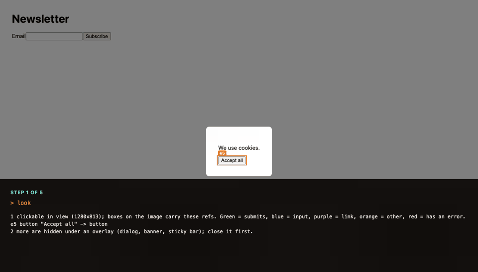

<p align="center">
  
</p>

<h1 align="center">Ostler</h1>

<p align="center">
  <a href="https://github.com/inamdarmihir/ostler/actions/workflows/ci.yml"></a>
  <a href="LICENSE"></a>
  
  
  <a href="https://inamdarmihir.github.io/ostler/"></a>
</p>

<p align="center">
  <b>A headless browser for AI coding agents that checks its own work: it fills a whole form in one call and reads every value back.</b><br>
  Rust · MCP · A2A · Chrome · <a href="https://qdrant.tech">Qdrant</a> memory
</p>

<p align="center">
  
</p>
<p align="center"><sub>Real tool output, recorded against the bundled local test pages (<code>ostler fixtures</code>). Nothing real is submitted.</sub></p>

> **Status: v0.2, early.** Tested against real Chrome and a real Qdrant server, but mostly on local fixtures, not the open web. A [design review](docs/REVIEW-2026-10.md) found real flaws; they are listed openly with a fix order. Read [what that means](docs/ECONOMICS.md#6-what-can-go-wrong) before relying on it. Nothing has been audited by a third party.

## Install

Needs **Chrome or Chromium** and Rust 1.89+.

```sh
cargo install --git https://github.com/inamdarmihir/ostler ostler
ostler doctor     # Chrome launches? Qdrant reachable (optional)? Prints the fix when not
```

**Releases are not published yet.** No release has been tagged, so the prebuilt-binary installer, `npx` and crates.io paths described in [docs/INSTALL.md](docs/INSTALL.md) will not work until the first release ([process](docs/RELEASING.md)). Build from source for now. macOS and Linux only; Windows is not built or tested.

## Works with Claude Code, Codex, Cursor

```sh
ostler setup claude --apply   # runs `claude mcp add` for you
ostler setup codex            # prints the block for ~/.codex/config.toml
ostler setup cursor           # prints JSON for ~/.cursor/mcp.json
```

Also `ostler setup vscode` and `ostler setup json` (generic `mcpServers`). Only Claude Code is applied automatically; other clients' files are never modified. See [docs/CLIENTS.md](docs/CLIENTS.md) and [docs/TROUBLESHOOTING.md](docs/TROUBLESHOOTING.md).

Try it: run `ostler fixtures` (synthetic test forms at http://127.0.0.1:8787), then ask your agent: *"Open http://127.0.0.1:8787/dependent.html and fill in the shipping form for Ada Lovelace in Germany, Bavaria."*

## What it does

Ostler is a general MCP browser (navigate, read, click, type, tabs, screenshots, a click-target overlay, shared notes) with a **form engine** and **Qdrant memory** on top. Forms are where it verifies the most, so they lead. Recipes for forms, reading, QA, logins and A2A are in the [cookbook](docs/COOKBOOK.md). Research and extraction are built as libraries but not yet tools; see [below](#beyond-forms-research-and-tasks-in-progress).

Instead of one click and one snapshot per field, the agent asks for the form's typed fields (`form_inspect`), sends `{label: value}` for the whole form (`form_fill`), and submits (`form_submit`). Dependent dropdowns, multi-step wizards, masks, comboboxes, shadow DOM and same-origin iframes are handled by the engine. Every value is **read back from the live page** and compared by field type, and a rejected submit returns the page's own messages. `look` returns a screenshot with numbered click targets.

Real output from the bundled fixtures (`ostler serve --tools forms`), lightly reformatted:

```text
> form_fill {"Country": "Germany", "State": "Bavaria", "Email": "ada@example.com"}
Filled 2/2 fields in 386ms (form e2).
  OK e4 "Country" = "de"
  OK e5 "State / region" = "by"        <- options loaded after Country changed
  UNMATCHED key "Email": no field on the page matches this key
Still empty and required:
  e3 "Recipient"

> form_submit
NOT ACCEPTED: the page reported problems.
  e3 "Recipient": "Please fill in this field."
```

A key that matches nothing is reported, not guessed; ties are `ambiguous`; a page that rewrites a date or picks a different combobox option is reported as a failure. The full `form_inspect` example, what strict verification means, and an at-a-glance feature table are in [docs/TOOLS.md](docs/TOOLS.md); a side-by-side with a snapshot-per-action browser is in [docs/COMPARISON-AND-ROADMAP.md](docs/COMPARISON-AND-ROADMAP.md).

Optional **memory** in [Qdrant](https://qdrant.tech) (or an encrypted local file, no server) saves profile facts and per-site playbooks of which fact fills which field, scoped per tenant and sealed on your machine by default. See [docs/MEMORY.md](docs/MEMORY.md). A second front door, [A2A](docs/A2A.md) over HTTP, lets other agents delegate forms.

## Beyond forms: research and tasks (in progress)

Ostler is being widened from forms to deep research and general browser tasks, keeping one idea: **verified**. Forms read every value back; research should refuse to cite what it did not read, and report pages it could not read as gaps. The plan of record is [docs/BUILD-PLAN.md](docs/BUILD-PLAN.md).

What exists today, as tested libraries (unit, property and real-Chrome / real-Qdrant tests):

| crate | what it does |
|---|---|
| `ostler-extract` | chunking, local BM25 ranking with MMR, quote verification (`verified` / `not found`), text-fragment links, prompt-injection flags, completeness checks. Pure logic, fuzz targets included. |
| `ostler-workflow` | `expect` postconditions, task contracts and verdicts, a redacted action trace with OpenTelemetry-shaped export, a risk-classed action gate, double-submit guard, receipt capture. |
| `ostler-research` | search-provider trait (SearXNG, Brave), RFC 9309 `robots.txt`, per-session budgets and per-host limits, a source ledger. |
| `ostler-memory` | a fourth memory kind, `source`: sealed document chunks with dense plus sparse (BM25) vectors, hybrid search through Qdrant's Query API with weighted RRF (client-side fusion on older servers), retention and wipe. |
| `ostler-browser` | readability-style `read`, table, list and pagination extraction, and a `diagnostics` console/network collector. |
| `ostler-fixtures`, `ostler-bench` | five **domain packs** (research, gov-forms, jobs, dev-qa, commerce; 34 tasks) and a **false-success** scorer: claimed success while the outcome failed. |

**Not done yet:** none of this is exposed as MCP tools. `read`, `extract`, `search`, `cite`, `open_many`, `task`, `diagnostics`, the `expect` parameter and tool presets are the next milestone (M1 in the plan). Until then an agent using Ostler over MCP still gets the form tools and `navigate`/`snapshot`. Search providers are only verified against mocks (Brave partly); there is no WARC archive; Qdrant Edge and local embeddings are decided against as defaults for now ([ADR-0012](docs/adr/0012-qdrant-edge-local-memory.md), [ADR-0013](docs/adr/0013-fastembed-local-embeddings.md)).

First scripted result across the packs (a deterministic script, not a model; [bench-results/packs-all-scripted.md](bench-results/packs-all-scripted.md)): 30 tasks ran, 29 true successes, **1 false success** (dev-qa-005: the script trusted a page's "saved" banner while the save had failed), 4 skipped because they need tools not wired yet. That trap is the point of the metric. Run it with `ostler-bench packs --scripted --pack all`.

## Benchmarks

**Scripted fixtures, model-free, estimated tokens.** Five local form tasks (basic, validation, dependent dropdowns, 3-step wizard, 20-field long form), one Apple M2, one Chrome, headless, with the real Playwright MCP and Chrome DevTools MCP servers using their own batch-fill tools. No LLM is in the loop: a script plays the shortest sensible sequence per server, and correctness is judged by what the fixture server received. All three completed all 5 tasks correctly. Totals over the 5 tasks (from [bench-results/compare.md](bench-results/compare.md)):

| server | tool calls | out tokens (est) | wall ms | tasks correct |
|---|---:|---:|---:|---:|
| Ostler | 19 | 1,550 | 4,077 | 5/5 |
| Playwright MCP | 27 | 2,960 | 8,755 | 5/5 |
| Chrome DevTools MCP | 28 | 1,866 | 7,919 | 5/5 |

Tool definitions sent every turn:

| server | tools | schema tokens (est) |
|---|---:|---:|
| Ostler | 21 | 1,513 |
| Playwright MCP | 25 | 5,265 |
| Chrome DevTools MCP | 32 | 7,416 |

Read this carefully: on the small forms Chrome DevTools MCP returned fewer tokens than Ostler (Ostler's replies carry the read-back), the step gap against batch-fill tools is about 1.4x, wall time is not an end-to-end latency, and a real model may behave differently. Whether read-back pays off was not exercised, since every tool succeeded. Method, caveats and more tables: [docs/BENCHMARKS.md](docs/BENCHMARKS.md#5-ostler-vs-playwright-mcp-vs-chrome-devtools-mcp-same-fixtures-scripted-agent). Reproduce with `scripts/bench-compare.sh`.

## What Ostler is not

- **Not a CAPTCHA solver or anti-bot tool.** CAPTCHAs and verification walls are reported with a `CHALLENGE:` line, never solved or bypassed; there is no stealth, user-agent spoofing or proxying. With `--headed`, `wait_for_human` lets a person clear the wall. See [docs/WEB-SEARCH.md](docs/WEB-SEARCH.md).
- **Not a Windows build.** macOS and Linux only; Windows is not built or tested.
- **Not a browser extension.** It launches its own Chrome and talks to it over a pipe.
- **Not hosted browsers.** It drives one local Chrome on your machine; nothing runs in a cloud.
- **Not audited or proven on the open web.** Mostly fixture-tested; see the status note above.

## Documentation

| topic | where |
|---|---|
| Install options, update, uninstall | [docs/INSTALL.md](docs/INSTALL.md) |
| Config file, env vars, which keys you need | [docs/CONFIGURATION.md](docs/CONFIGURATION.md) |
| Recipes for each use case | [docs/COOKBOOK.md](docs/COOKBOOK.md) |
| Tool list, `--tools auto`, tabs, example prompts | [docs/TOOLS.md](docs/TOOLS.md) |
| Memory, the learning loop, privacy model | [docs/MEMORY.md](docs/MEMORY.md) |
| CLI commands, `ostler serve` flags, A2A server | [docs/CLI.md](docs/CLI.md), [docs/A2A.md](docs/A2A.md) |
| Safety controls and what is still open | [docs/SAFETY.md](docs/SAFETY.md), [SECURITY.md](SECURITY.md), [docs/THREAT-MODEL.md](docs/THREAT-MODEL.md) |
| Searching the web, bot walls | [docs/WEB-SEARCH.md](docs/WEB-SEARCH.md) |
| Build plan, scope background, domain packs | [docs/BUILD-PLAN.md](docs/BUILD-PLAN.md), [docs/SCOPE-RESEARCH.md](docs/SCOPE-RESEARCH.md), [docs/SCOPE-TASKS.md](docs/SCOPE-TASKS.md) |
| Comparison with other tools, roadmap | [docs/COMPARISON-AND-ROADMAP.md](docs/COMPARISON-AND-ROADMAP.md), [docs/ROADMAP.md](docs/ROADMAP.md) |
| Earlier README benchmark table, full benchmarks, economics | [docs/BENCHMARK-SUMMARY.md](docs/BENCHMARK-SUMMARY.md), [docs/BENCHMARKS.md](docs/BENCHMARKS.md), [docs/ECONOMICS.md](docs/ECONOMICS.md) |
| Architecture, system design, ADRs | [docs/ARCHITECTURE.md](docs/ARCHITECTURE.md), [docs/SYSTEM-DESIGN.md](docs/SYSTEM-DESIGN.md), [docs/adr/](docs/adr/) |
| Operations, failure modes, SLOs, compatibility, testing | [docs/OPERATIONS.md](docs/OPERATIONS.md), [docs/FAILURE-MODES.md](docs/FAILURE-MODES.md), [docs/SLOS.md](docs/SLOS.md), [docs/COMPATIBILITY.md](docs/COMPATIBILITY.md), [docs/TESTING.md](docs/TESTING.md) |
| Design review, research | [docs/REVIEW-2026-10.md](docs/REVIEW-2026-10.md), [docs/research/landscape.md](docs/research/landscape.md) |
| Releasing | [docs/RELEASING.md](docs/RELEASING.md) |
| Website | [inamdarmihir.github.io/ostler](https://inamdarmihir.github.io/ostler/) |

Repository layout: `crates/` cdp · browser · forms · extract · workflow · research · memory · mcp · a2a · cli · fixtures · bench; test pages in `crates/ostler-fixtures/fixtures/`. See also the [changelog](CHANGELOG.md) and [contributing](CONTRIBUTING.md).

## License

Apache-2.0. See [LICENSE](LICENSE).
