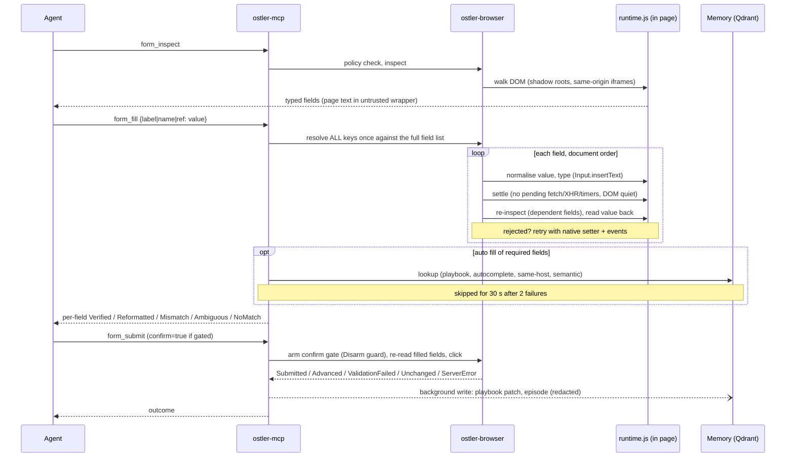
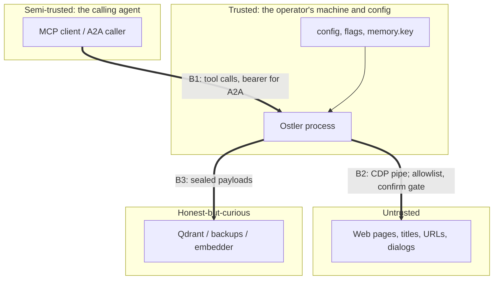

# System design

What Ostler is, what it depends on, where it stops. Component detail is in [ARCHITECTURE.md](ARCHITECTURE.md); the reasoning behind single decisions is in [`adr/`](adr/). This page is the view from outside: boundaries, data flow, constraints, capacity, trade-offs. Statements are traceable to code or to measurements in [BENCHMARKS.md](BENCHMARKS.md) and [ECONOMICS.md](ECONOMICS.md); intended-but-unbuilt items say **planned**.

## 1. Context

```mermaid
flowchart LR
  subgraph Callers
    A1["Coding agent<br/>(Claude Code, Codex, Cursor)"]
    A2["Remote agent / service"]
    U["Local user<br/>(CLI, config, key file)"]
  end
  subgraph Host["One machine"]
    MCP["ostler serve<br/>MCP over stdio"]
    A2A["ostler a2a<br/>HTTP, JSON-RPC, SSE"]
    CORE["ostler-mcp app<br/>tools, policy, metrics"]
    BR["ostler-browser<br/>fill engine, runtime.js"]
    CDP["ostler-cdp<br/>pipe to Chrome"]
    CH["Chrome (headless)"]
    MEM["ostler-memory<br/>SealedStore"]
    LOC[("memory.local<br/>(optional)")]
  end
  Q[("Qdrant<br/>local or Cloud")]
  OL["Ollama<br/>(optional embedder)"]
  W["Websites<br/>(untrusted)"]

  A1 -->|stdio| MCP --> CORE
  A2 -->|"HTTP + bearer"| A2A --> CORE
  U --> MCP
  CORE --> BR --> CDP --> CH -->|HTTP(S)| W
  CORE --> MEM
  MEM -->|"sealed payloads (HTTPS)"| Q
  MEM -.-> LOC
  MEM -.->|vectors only| OL
```

Ostler is a tool, not a model. It never calls an LLM; the calling agent supplies intent and Ostler supplies observation, a verified fill, and a typed outcome.

## 2. Components

| component | responsibility | state it owns |
|---|---|---|
| `ostler-cdp` | One pipe connection to Chrome, id-matched requests, target sessions, Chrome launch | Chrome process, temp profile dir |
| `ostler-browser` | `Page`, fill/verify/submit engine, domain policy, injected `runtime.js` | tabs, per-page settle state, last filled form |
| `ostler-forms` | Pure logic: form IR, key matching, value normalisation, sensitive-field detection | none (no I/O) |
| `ostler-memory` | Facts, playbooks, episodes behind a `Store` trait (`QdrantStore`, `InMemoryStore`, local file, `SealedStore`) | tenant data (remote or file) |
| `ostler-mcp` | JSON-RPC loop, tool catalogue and profiles, safety gates, per-tool metrics, background memory writes | session metrics, circuit breaker |
| `ostler-a2a` | A2A HTTP surface, per-conversation `Ctx` (own Chrome), task state | conversations |
| `ostler` CLI | `serve`, `a2a`, `init`, `doctor`, `install`, `memory`, `config`, `fixtures` | config file, `memory.key` |

## 3. Data flow: `form_fill` then `form_submit`



Properties that hold on this path: ambiguity is reported, never guessed ([ADR-0005](adr/0005-form-ir-and-verification.md)); a value counts as filled only after read-back; `ServerError` is never reported as submitted; memory writes are off the response path; a cancelled or timed-out submit closes the confirm gate again.

## 4. Trust boundaries



| id | boundary | enforced by |
|---|---|---|
| B1 | agent to Ostler | tool schema validation, profiles, A2A bearer/`Origin`/`Host` checks |
| B2 | Ostler to web page | in-browser request interception, resolver rule, `<page_content untrusted>` fencing, upload and dialog rules |
| B3 | Ostler to Qdrant | client-side sealing (AES-256-GCM, keyed hashes), `http://` refusal, tenant filter or per-tenant collections |
| B4 | local user to Chrome | pipe transport (no debug port), throwaway profile |

Per-boundary analysis: [THREAT-MODEL.md](THREAT-MODEL.md).

## 5. Explicit constraints

| constraint | consequence | source |
|---|---|---|
| **Needs Chrome/Chromium** (local binary or `--cdp-url` to a loopback Chrome) | no Chrome, no tools; `doctor` checks this. Other engines are a planned backend only | ADR-0001, ARCHITECTURE "Known limits" |
| **One Chrome per session** (about 450-550 MiB each in the concurrency bench) | A2A caps conversations (`--max-contexts`, default 4) and closes idle ones (`--idle-secs`, default 300) | BENCHMARKS s3, `docs/A2A.md` |
| **Single-tenant by design over stdio**: one process, one agent, one user, one memory tenant | no per-caller auth on MCP; the OS user boundary is the boundary | `ostler serve` |
| **A2A is not multi-tenant**: all conversations share one memory tenant, no TLS | one server per tenant, TLS via reverse proxy | `docs/A2A.md` |
| **Token budget**: tool schemas stay under 7 KB (unit test); `auto` profile starts with 14 of 23 tools; outputs terse by default, delta snapshots after actions | adding a tool is a context-cost decision, not free | ECONOMICS s7 |
| **Latency budget**: the browser should be a small slice of a task because LLM turns dominate (>99 percent of cost). Fixture measurements: about 160 ms per action after the settle fix; real-site timings are not yet measured at scale | optimise call count and output size before engine speed | ADR-0007 |
| **Runtime shares the page's JS world** | a hostile page can mislead what the agent is told; cannot see closed shadow roots or cross-origin frames | ADR-0004, SECURITY |
| **Memory is optional and degradable** | with no Qdrant: in-process (session only) or `--memory local` file; Qdrant failures skip lookups, never block a fill | ARCHITECTURE |
| **Platforms**: CI runs Linux; release builds also macOS (arm64, x86_64) and Linux arm64. Windows is not built or tested | see [COMPATIBILITY.md](COMPATIBILITY.md) | `ci.yml`, `release.yml` |

## 6. Non-goals

- Solving CAPTCHA, 2FA, anti-bot evasion or managing logins beyond `--profile-dir`. Walls are detected and handed to a person ([ADR-0009](adr/0009-challenges-are-handed-off.md)).
- Being a hosted multi-tenant browser service (isolation, abuse handling, proxies are not built).
- Being a general scraping or crawling engine.
- Understanding free text. Requests are structured; A2A answers chatter with the expected shape.
- Being a sandbox against a compromised browser or a hostile local user with your account.
- Emulating a model: no LLM in the loop, so no claim about end-to-end agent success rates is made without a measured evaluation (ADR-0007).

## 7. Capacity assumptions

Measured on one 8-core laptop with fixtures (see [ECONOMICS.md](ECONOMICS.md) s3); treat as first-order planning numbers, not guarantees.

| assumption | value | status |
|---|---|---|
| Parallel sessions per 8-core node | 8 gave 354-393 tasks/min, p95 under 1 s, 100 percent success | measured, fixtures |
| Memory per session | 450-550 MiB | measured, macOS, fixtures |
| Planning rule | about 14 sessions per 8 GB, about 120 per 64 GB | derived, unvalidated on Linux or real sites |
| Qdrant retrieval | about 0.4 ms p50 from 20k to 200k points (tenant payload index) | measured, hash vectors |
| Qdrant RAM per point | about 6.8-8.4 KB untuned at 200k points | measured, upper-ish bound; sizing study **planned** |
| Real sites | heavier than fixtures; expect more CPU and RAM per page | assumption |

## 8. Key trade-offs

| decision | chosen | gave up | why |
|---|---|---|---|
| In-page runtime vs CDP accessibility tree | injected `runtime.js` | isolation from the page's JS world | one round-trip answers what takes dozens of CDP calls; sees shadow DOM and same-origin iframes uniformly (ADR-0004) |
| Form IR + one-call fill vs click/type primitives | typed IR, verified fill | generality for odd widgets | fewer turns and tokens per completed form, which is where the cost is |
| Report ambiguity vs guess | refuse and list candidates | some one-shot successes | wrong fills reported as success are worse than a second call |
| Seal before upload vs server-side features | client-side encryption, keyed hashes | server-side text search and inspectability; lost key means lost memory | Qdrant, its operator and backups see no plaintext (ADR-0006) |
| Pipe vs WebSocket CDP | pipe | easy ad-hoc debugging (ws mode kept for that) | no listening port, Chrome exits with the server |
| Allowlist in the browser vs in the tool layer | request interception plus resolver rule | simplicity | checks after the fact let requests escape (review 2026-10) |
| Open by default on `serve`, closed on `a2a` | loopback/LAN allowed on `serve` | safe default for local dev servers | coding agents browse localhost; remote callers must not probe the host |
| Hand off challenges vs solve | hand off | automation on protected sites | integrity and legal exposure (ADR-0009) |
| Stdio only for MCP | stdio | remote MCP | smallest attack surface; A2A covers the remote case; streamable HTTP is on the [roadmap](ROADMAP.md) |
| Measure before claiming | publish caveats and losses | marketing headroom | the first benchmarks found real bugs (ADR-0007) |
